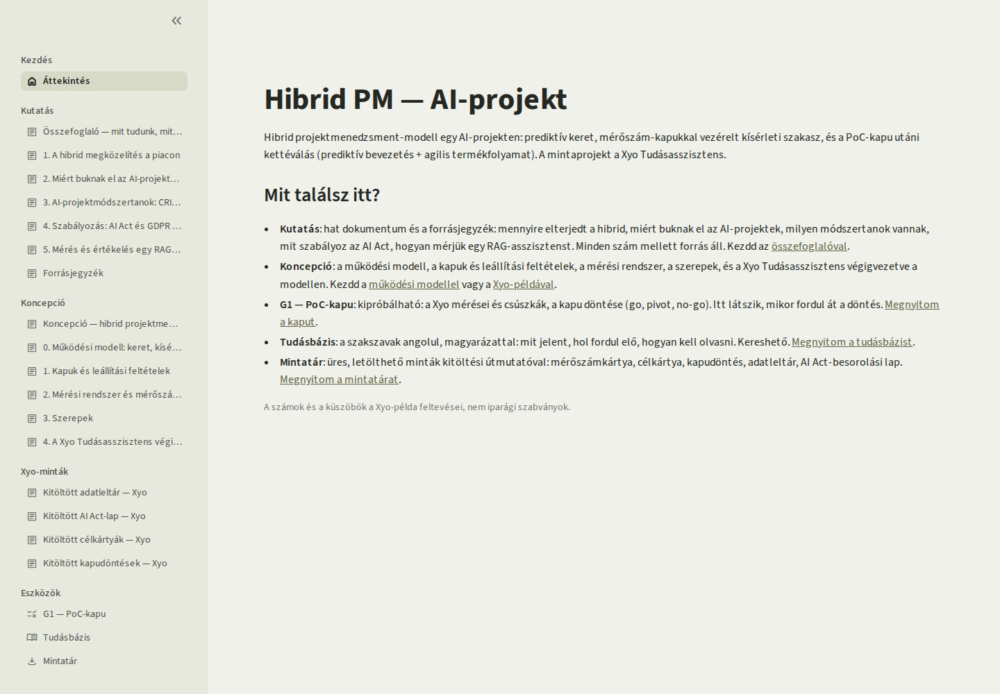
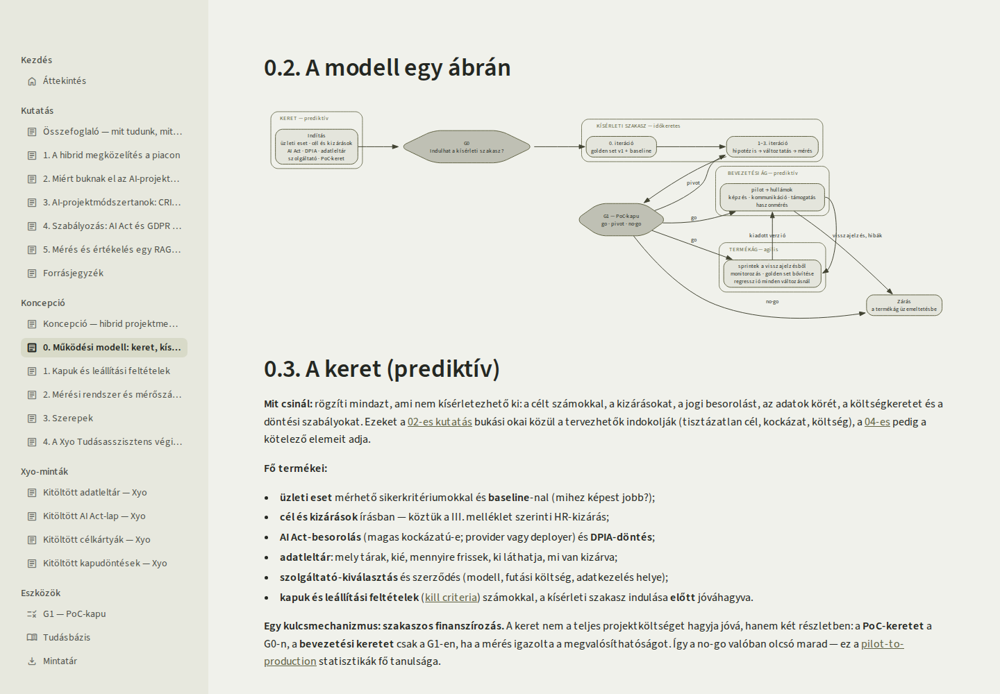
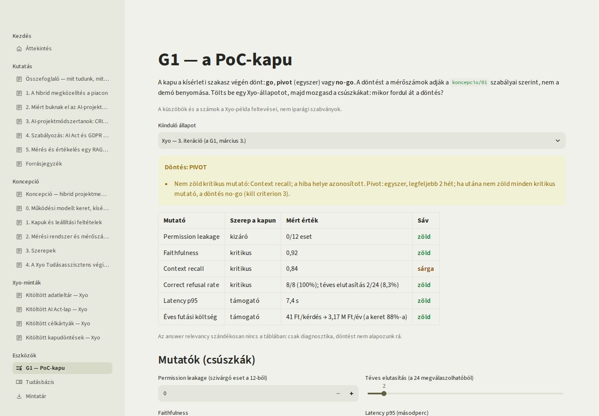
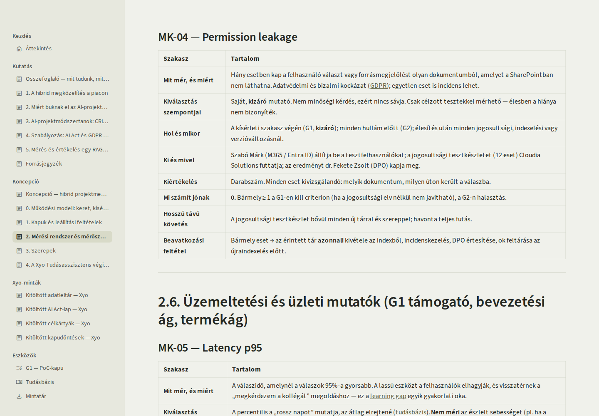
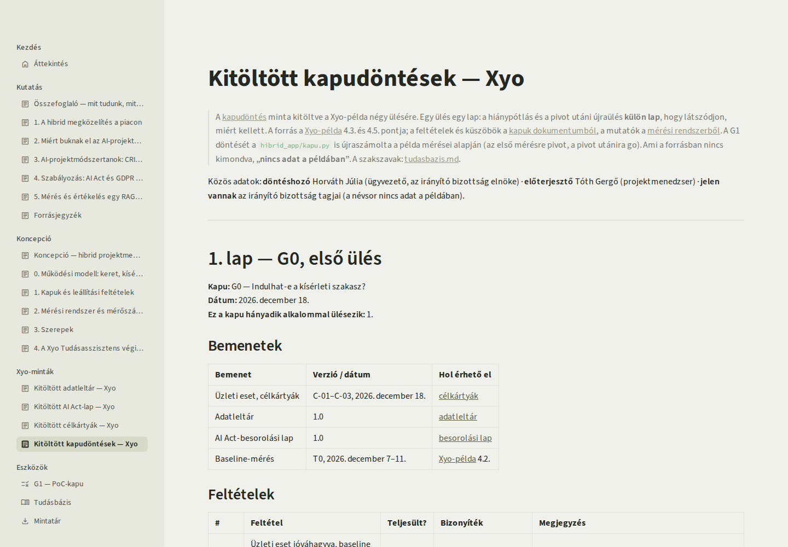
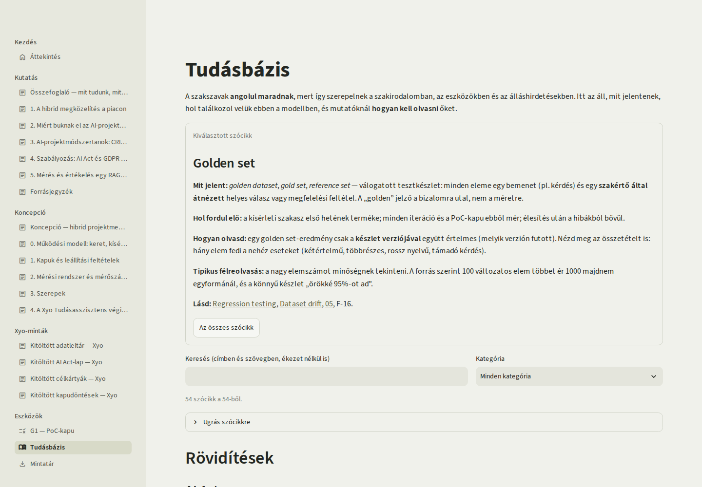
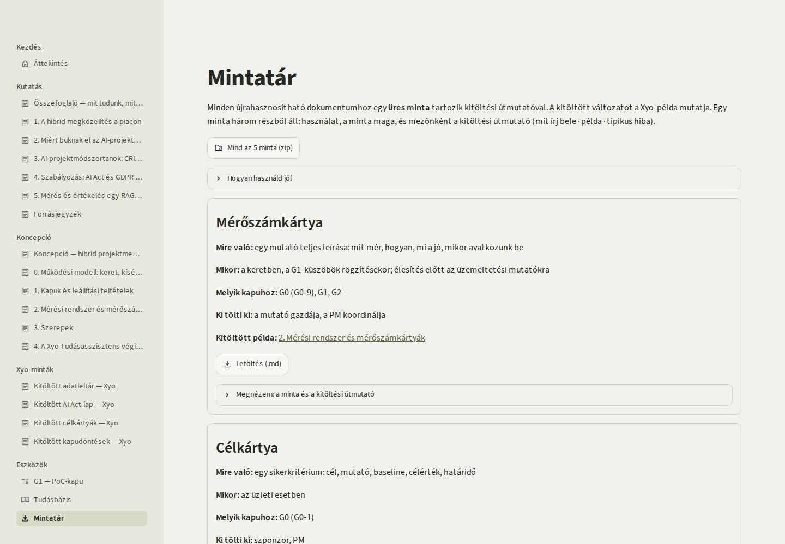

# Hibrid PM — projektmenedzsment egy AI-projekten

A Hibrid PM egy általam összeállított **kutatás, módszertan és működő bemutató** arról, hogyan lehet egy
**AI-projektet** egyszerre prediktív és kísérleti módon vezetni. A mintaprojekt egy kitalált vállalati RAG
chatbot: a **Xyo Tudásasszisztens**, amely a Xyo Kft. SharePoint-dokumentumtárára épül.

Az AI-projektekben nem csak az igény bizonytalan — amit az agilis módszerek kezelnek —, hanem az is, hogy a
feladat **egyáltalán megoldható-e a kért minőségben**. Erre sem a rögzített scope, sem a sprint nem ad
választ: mérés kell hozzá. Ezért a modell három részből áll:

| Rész | Kérdés | Hogyan dönthető el |
|---|---|---|
| **Prediktív keret** | Mit akar az üzlet, és mit enged a jog? | elemzéssel, jóváhagyással — előre |
| **Kísérleti szakasz** (időkeretes) | Megoldható-e a feladat a kért minőségben, ezzel az adattal? | csak méréssel, kipróbálva |
| **Kettéválás** a PoC-kapu után | Beválik-e a munkában, és jó marad-e? | bevezetéssel és folyamatos méréssel: prediktív bevezetési ág + agilis termékág |

A három részt **kapuk** kötik össze, számszerű küszöbökkel és előre kimondott leállítási feltételekkel
(*kill criteria*): a PoC-kapun a mérőszámok döntenek *go*, *pivot* vagy *no-go* között, nem a demó
benyomása.

> **English summary.** *Hybrid PM is a research-backed method and a working demo for managing an AI project
> with a predictive frame, a time-boxed experimental phase and a split after the PoC gate (predictive
> rollout plus an agile product stream). The sample project is a fictional enterprise RAG assistant over a
> company's SharePoint libraries. The point is that feasibility cannot be planned, only measured: so the
> frame fixes what can be decided up front (business case, GDPR/AI Act, data inventory, budget), the
> experimental phase measures quality against numeric thresholds, and a gate with explicit kill criteria
> decides go / pivot / no-go. The repository contains six research documents with a graded source list, five
> concept documents, reusable blank templates with filled-in examples, a glossary of 54 terms and an
> interactive PoC-gate calculator. Built with Python and Streamlit.*

## Mit találsz itt?

| Rész | Tartalom |
|---|---|
| [`kutatas/`](kutatas/) | piaci és módszertani kutatás (6 dokumentum), forrásjegyzék **18 forrással**, megbízhatósági szintezéssel; tudásbázis **54 szakszóval** |
| [`koncepcio/`](koncepcio/) | működési modell, kapuk és leállítási feltételek, mérési rendszer (8 mérőszámkártya), szerepek, a Xyo Tudásasszisztens végigvezetve |
| [`koncepcio/sablonok/`](koncepcio/sablonok/) | 5 üres, letölthető minta kitöltési útmutatóval |
| [`koncepcio/xyo-mintak/`](koncepcio/xyo-mintak/) | ugyanazok a minták kitöltve, a Xyo-példával |
| [`app.py`](app.py), [`hibrid_app/`](hibrid_app/) | a Streamlit-felület: dokumentumok, interaktív G1-kapu, tudásbázis, mintatár |
| [`tests/`](tests/), [`tools/`](tools/) | automatizált tesztek; dokumentum- és böngészős ellenőrzés |
| [`docs/adr/`](docs/adr/) | három döntésnapló-bejegyzés: miért ez a modell, miért ez a szerkezet, miért ez az arculat |

## Képernyőképek

*Az áttekintés: kutatás, koncepció és eszközök egy helyen.*

| | |
|---|---|
|  |  |
| **A modell egy ábrán:** keret → G0 → kísérleti szakasz → G1 → bevezetési ág és termékág. | **A PoC-kapu kipróbálható:** a mért értékekből a kód adja a go / pivot / no-go döntést, indoklással. |
|  |  |
| **Mérőszámkártya:** mit mér, hogyan kell olvasni, mikor avatkozunk be, ki a gazdája. | **Kitöltött minta:** a Xyo-példa négy kapuülése, hiánypótlással és pivottal. |
|  |  |
| **Tudásbázis:** a szakszavak angolul maradnak; mit jelent, hol fordul elő, hogyan kell olvasni, tipikus félreolvasás. | **Mintatár:** minden újrahasznosítható dokumentumhoz üres minta, útmutatóval; egyben letölthető. |

## Hogyan használható?

- **Tudásanyagként:** a kutatás összefoglalója ([`kutatas/00-osszefoglalo.md`](kutatas/00-osszefoglalo.md))
  hat tanulságban mondja el, mit tudunk az AI-projektek bukásáról és a hibrid módszerekről. Minden szám mellett
  forrás áll, megbízhatósági szinttel; a meg nem erősített adat kimaradt.
- **Módszertanként:** a [működési modell](koncepcio/00-mukodesi-modell.md) és a
  [kapuk](koncepcio/01-kapuk-es-kill-criteria.md) egy másik AI-projektre is átvihetők.
- **Sablontárként:** a [`koncepcio/sablonok/`](koncepcio/sablonok/) üres mintái (mérőszámkártya, célkártya,
  kapudöntés, adatleltár, AI Act-besorolási lap) kitöltési útmutatóval és kitöltött példával.
- **Tanulóeszközként:** a G1-kapuban a mért értékeket mozgatva látszik, mikor fordul át a döntés.

A szövegekben a `PROJ_pm_all` a waterfall testvérprojektre utal, amelynek Xyo Kft.-s felhőpilotja a mintaprojekt
előzménye (nyilvános változata: [`pm-all-showcase`](https://github.com/htgitacc/pm-all-showcase)).

## A mintaprojekt: Xyo Tudásasszisztens

Egy kitalált, 240 fős cég (Xyo Kft.) belső tudásasszisztense. A pilot négy SharePoint-tárra épül (kb. 1 900
dokumentum), a kísérleti szakasz 7 hétig tart, a PoC-keret 6,5 M Ft. A példa a keretet, a két G0-ülést, a
kísérleti szakasz iterációit, egy pivotot, a G1-döntést és a kettéválás utáni két ágat is végigviszi, többek közt
egy kizárást sértő változáskérés elutasításával. **A számok és a küszöbök a példa feltevései, nem iparági
szabványok.** A példa azt igazolja, hogy a modell végigvihető egy teljes projekten — nem azt, hogy ezek a számok
általánosak.

## Minőségbiztosítás

- **A szöveg:** a `tools/ellenorzes.py` ellenőrzi a forráshivatkozásokat, a tudásbázis-horgonyokat és a belső
  linkeket; hibás hivatkozás esetén hibával áll le.
- **A felület:** 443 automatizált teszt (Streamlit AppTest), amelyek a dokumentumok, a mintatár, a tudásbázis és a
  G1-döntéslogika viselkedését fedik le. A kritikus teszteket szándékos elrontással is megpróbáltam megbuktatni.
- **A böngészőben:** a `tools/felulet_ellenorzes.py` (Playwright) 21 oldalt vizsgál 390 és 1440 px szélességen:
  vízszintes túlcsordulás, linkek, letöltések, az ábra viselkedése.
- **A kontraszt:** a szövegszínek WCAG AA-kontrasztját teszt őrzi.

## Hogyan készült?

A kutatást, a koncepciót és a felületet AI-asszisztenssel (Claude) közös munkában állítottam össze,
rövid iterációkban, és minden fázist külön jóváhagytam. A kutatásba csak megnyitott és elolvasott forrás
kerülhetett; ami nem volt megerősíthető, azt kihagytuk, és a forrásjegyzék végén felsoroljuk.

## Indítás és tesztek

    python3 -m venv .venv
    .venv/bin/pip install -r requirements-dev.txt
    .venv/bin/streamlit run app.py          # a felület
    .venv/bin/python -m pytest              # a tesztek
    .venv/bin/ruff check .                  # a stílusellenőrzés
    python3 tools/ellenorzes.py             # források, tudásbázis-horgonyok, belső linkek

A böngészős ellenőrzéshez és a képernyőképekhez egyszer: `.venv/bin/playwright install chromium`, majd
`.venv/bin/python tools/felulet_ellenorzes.py` és `.venv/bin/python tools/screenshots.py`.
