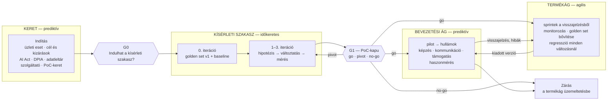

# 0. Működési modell: keret, kísérleti szakasz, kettéválás

> **Mit ad ez a dokumentum?** A modell vázát: milyen részekből áll egy hibrid AI-projekt, melyik
> rész melyik bizonytalanságot kezeli, hol vannak a döntési kapuk, és hogyan kapcsolódik
> egymáshoz a prediktív és az agilis munka. A részleteket a további koncepciódokumentumok
> bontják ki; a kitöltött példa a Xyo Tudásasszisztens.
>
> **Kiindulópont** (a kutatásból, [00](../kutatas/00-osszefoglalo.md)): a hibrid **önmagában nem
> jobb**. Attól jó, ha a részei valóban más-más bizonytalanságot kezelnek. Ez a modell ezért nem
> a módszerek keveréke, hanem a bizonytalanságok **szétválasztása**.

A szakszavak magyarázata: [tudasbazis.md](../kutatas/tudasbazis.md).

---

## 0.1. Három bizonytalanság, három rész

| Bizonytalanság | Kérdés | Hogyan dönthető el | A modell része |
|---|---|---|---|
| **Üzleti és jogi** | Mit akarunk, mennyiért, mit enged a jog, mit zárunk ki? | elemzéssel, egyeztetéssel, jóváhagyással — **előre** | **Keret** (prediktív) |
| **Megvalósíthatósági** | Megoldható-e a feladat a kért minőségben, ezzel az adattal? | **csak méréssel**, kipróbálva | **Kísérleti szakasz** (időkeretes) |
| **Használati** | Beválik-e a munkában, és jó marad-e, ahogy változik az adat és a kérdések? | bevezetéssel és folyamatos méréssel | **Kettéválás** után: **bevezetési ág** (prediktív) + **termékág** (agilis) |

A három rész sorrendje nem véletlen: a kísérleti szakaszt nem érdemes elindítani, amíg a keret nem mondta
meg, **mit** és **milyen adattal** szabad kipróbálni; a bevezetést nem érdemes megtervezni, amíg
a kísérleti szakasz nem mutatta ki, hogy **működik**.

## 0.2. A modell egy ábrán

## 0.3. A keret (prediktív)

**Mit csinál:** rögzíti mindazt, ami nem kísérletezhető ki: a célt számokkal, a kizárásokat, a
jogi besorolást, az adatok körét, a költségkeretet és a döntési szabályokat. Ezeket a [02-es
kutatás](../kutatas/02-miert-buknak-el-az-ai-projektek.md) bukási okai közül a tervezhetők
indokolják (tisztázatlan cél, kockázat, költség), a [04-es](../kutatas/04-szabalyozas.md) pedig a
kötelező elemeit adja.

**Fő termékei:**

- **üzleti eset** mérhető sikerkritériumokkal és **baseline**-nal (mihez képest jobb?);
- **cél és kizárások** írásban — köztük a III. melléklet szerinti HR-kizárás;
- **AI Act-besorolás** (magas kockázatú-e; provider vagy deployer) és **DPIA-döntés**;
- **adatleltár**: mely tárak, kié, mennyire frissek, ki láthatja, mi van kizárva;
- **szolgáltató-kiválasztás** és szerződés (modell, futási költség, adatkezelés helye);
- **kapuk és leállítási feltételek** ([kill criteria](../kutatas/tudasbazis.md#kill-criteria))
  számokkal, a kísérleti szakasz indulása **előtt** jóváhagyva.

**Egy kulcsmechanizmus: szakaszos finanszírozás.** A keret nem a teljes projektköltséget hagyja
jóvá, hanem két részletben: a **PoC-keretet** a G0-n, a **bevezetési keretet** csak a G1-en, ha a
mérés igazolta a megvalósíthatóságot. Így a no-go valóban olcsó marad — ez a
[pilot-to-production](../kutatas/tudasbazis.md#pilot-to-production-rate) statisztikák fő
tanulsága.

## 0.4. A kísérleti szakasz (időkeretes)

**Mit csinál:** méréssel eldönti, hogy a feladat megoldható-e a kért minőségben. A munkát a
[CPMAI](../kutatas/tudasbazis.md#cpmai) 2–5. fázisa adja (adatmegértés, adatelőkészítés,
„modellfejlesztés” — RAG-nál a keresés és a prompt beállítása —, értékelés), [eval-driven
development](../kutatas/tudasbazis.md#eval-driven-development) módon.

**Szabályai:**

1. **Az idő rögzített, a minőség a kimenet.** A kísérleti szakasz időkerete (a Xyo-példában 7 hét) nem
   hosszabbítható meg kapudöntés nélkül. Ez a [timebox](../kutatas/tudasbazis.md#timebox).
2. **Az első iteráció a mérést építi**, nem a rendszert: [golden set](../kutatas/tudasbazis.md#golden-set)
   v1 (20–50 átnézett elem) és **baseline-mérés** egy egyszerű kiinduló beállítással.
3. **Minden további iteráció egy hipotézisre épül** („ha a darabolást X-re váltjuk, a context
   recall nő”), egy változtatással, és a teljes készlet újrafuttatásával
   ([regression testing](../kutatas/tudasbazis.md#regression-testing)).
4. **Az iteráció végén az üzlet is lát** egy rövid bemutatót a mérési eredménnyel — nem demót,
   hanem számokat és néhány kiválasztott esetet.
5. **A kísérleti szakasz valós adattal csak a G0 után dolgozhat** — a DPIA-döntés és az adatleltár kizárásai
   addigra rögzítettek.

## 0.5. A kettéválás: bevezetési ág és termékág

A G1-en „go” döntés után a projekt **két, egymással szinkronizált ágra** válik. Ez a modell
legsajátosabb eleme: a bevezetés és a továbbfejlesztés más ritmusú munka, ezért más módszert kap.

| | **Bevezetési ág** (prediktív) | **Termékág** (agilis) |
|---|---|---|
| Kérdése | Átveszik-e a felhasználók, időben és a kereten belül? | Jó marad-e, és jobb lesz-e a használat alapján? |
| Munkája | pilot, hullámok, képzés ([AI literacy](../kutatas/tudasbazis.md#ai-literacy)), kommunikáció, támogatás, haszonmérés | visszajelzés-feldolgozás, javítások, golden set bővítése, monitorozás |
| Ritmusa | mérföldkövek, ütemterv, hullámonkénti élesítési kapu | kéthetes sprintek |
| Felelőse | projektmenedzser | termékfelelős (*product owner*) |
| Vége | az utolsó hullám élesítése és a haszonmérés indulása | nincs vége: a projekt zárásakor **üzemeltetésbe** kerül, termékként él tovább |

**A két ág kapcsolata** — ez a hibrid legkényesebb pontja:

- a termékág **verziókat ad ki**; a bevezetési ág dönti el, melyik hullám melyik verziót kapja (egy
  hullám közben nem cserélünk verziót, csak hibajavítást);
- a bevezetési ág **visszajelzést és hibákat** ad a termékágnak; ezek a termékág backlogjába
  kerülnek;
- a **közös mérőszámok** (a mérési rendszer szerint) mindkét ág döntéseit vezérlik;
- a **scope-határ a keretnél marad**: ha a termékágba olyan kérés érkezik, amely átlépi a keret
  kizárásait (pl. egyéni HR-összefoglaló), az nem backlog-elem, hanem **változáskérés a
  keretnek** — és ha a besorolást érinti, új projekt.

## 0.6. Zárás

A projekt akkor zárul, amikor az utolsó bevezetési hullám élesítése megtörtént, a haszonmérés
elindult, és a termékágat az üzemeltetés átvette (felelős, költségkeret, mérési ritmus,
beavatkozási szabályok). A haszonmérés — a `PROJ_pm_all` mintájára — a zárás után, külön
időszakban fut.

## 0.7. Mit nem állít ez a modell

- **Nem** azt, hogy minden AI-projekt így épüljön fel. Egy kész SaaS-chatbot bekapcsolása
  belső adat nélkül nem igényel kísérleti szakaszt; egy kutatási célú ML-projekt nem igényel bevezetési ágat.
- **Nem** nagyvállalati skálázási keretrendszer (mint a SAFe): egy közepes cég egy projektjére
  készült.
- **Nem** állítja, hogy a hibrid jobb eredményt hoz (lásd [01](../kutatas/01-hibrid-a-piacon.md)) —
  csak azt, hogy itt a részek más-más bizonytalanságot kezelnek, ezért indokolt.

## 0.8. A Xyo Tudásasszisztens ezen a vázon

| Elem | A Xyo-példában (az időpontok feltevések) |
|---|---|
| Kiváltó ok | a Cloud Pilot után megnőtt a SharePointon dokumentált tudás mennyisége (`PROJ_pm_all` PIR); a keresés lassú, a kollégák egymást kérdezik |
| Keret | 2026. december — 3 hét (egy hiánypótlással január elejéig); döntéshozó az irányító bizottság (Horváth Júlia), szponzor Kovács Anita |
| G0 | 2026. december közepe, hiánypótlás után 2027. január eleje |
| Kísérleti szakasz | 2027. január–február — 7 hét (egyhetes 0. iteráció + 3 kéthetes iteráció), a pilot 50 fős körének SharePoint-tárain |
| G1 | 2027. március eleje |
| Bevezetési ág | pilot az 50 fős körrel, majd a felhő-kiterjesztés **hullámait követve** a maradék 190 főre; a kiterjesztés 2027-01-11 és 2027-09-30 között fut (`PROJ_pm_all` kiterjesztési javaslat) — az asszisztens egy hullámot csak akkor kap meg, ha annak SharePoint-tárai már élnek |
| Termékág | G1-től folyamatos, kéthetes sprintek |
| Zárás | 2027 ősz, az utolsó hullám után |

**Függőség a `PROJ_pm_all`-lal:** a bevezetési ág ütemezése a felhő-kiterjesztés hullámaihoz
kötött — ez **külső, prediktív függőség**, amelyet a keret kockázatként kezel. Ha a kiterjesztés
csúszik, a bevezetési ág is csúszik; a kísérleti szakasz és a termékág nem.
